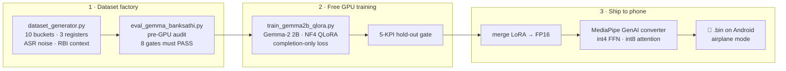
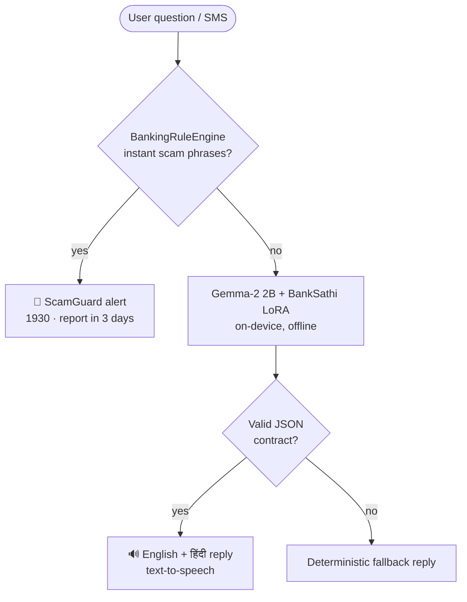
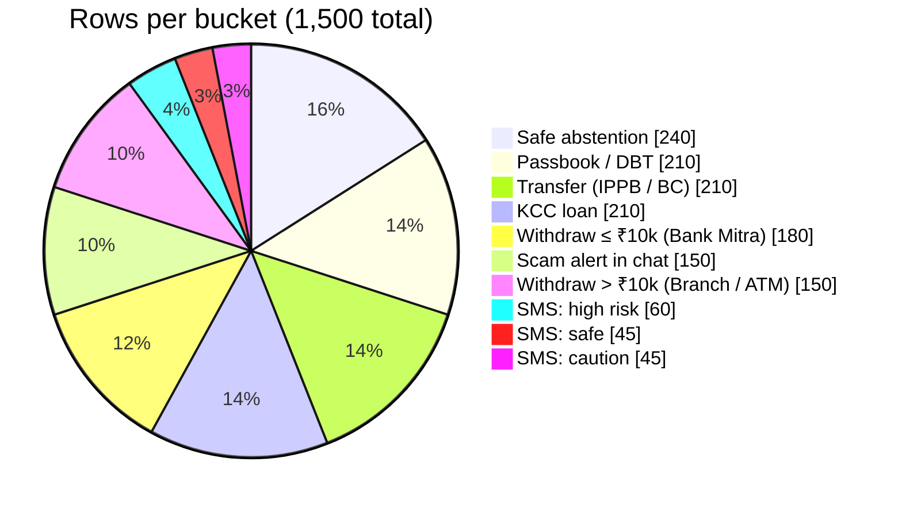
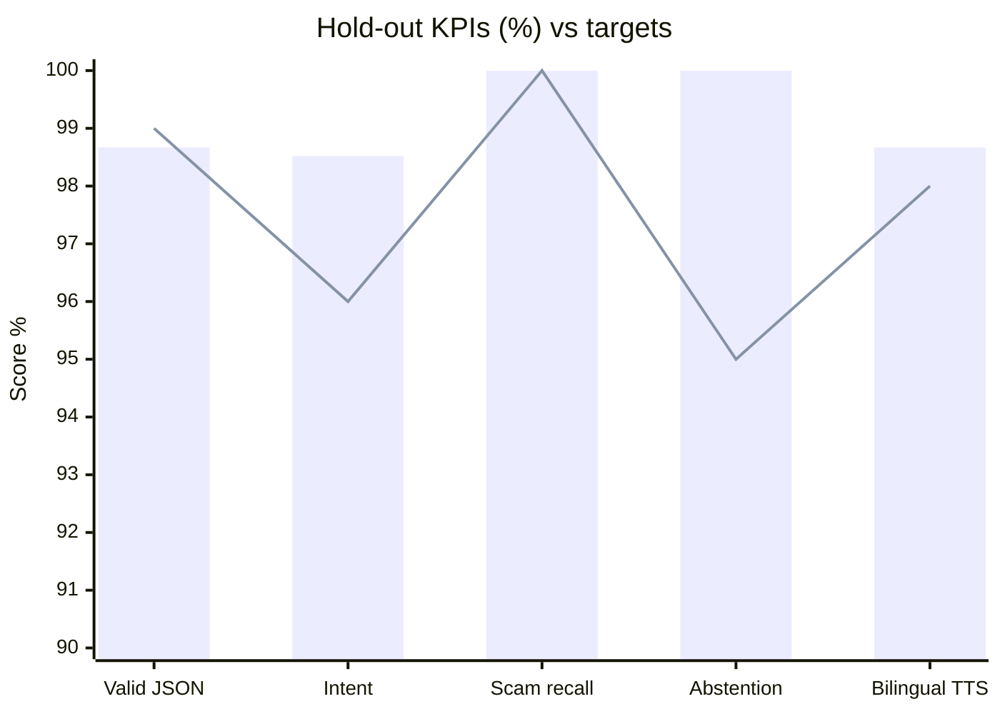
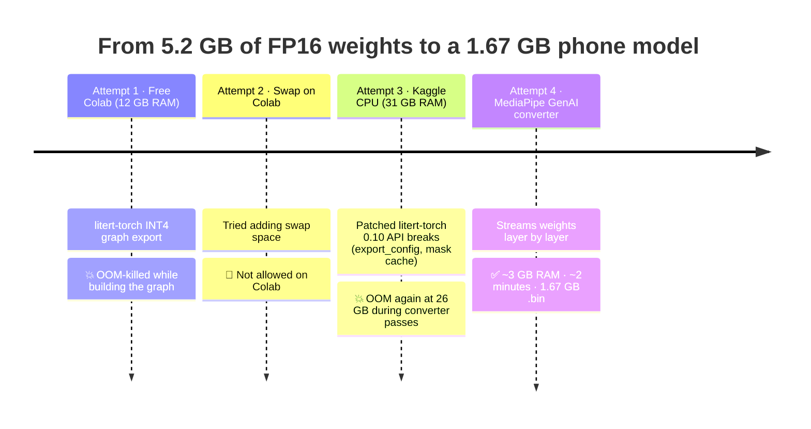

<div align="center">

# 🏦 BankSathi

### A 2-billion-parameter banking assistant that fits in a farmer's pocket and works with no internet.

**English · हिंदी · Hinglish** — fine-tuned Gemma-2 2B, trained for **₹0** on free GPUs, built to run **100% offline** on Android.

[](https://huggingface.co/0xr4j/banksathi-gemma2-2b)
[](https://huggingface.co/google/gemma-2-2b-it)
[](#-training-70-minutes-on-a-free-t4)
[](#-getting-it-onto-a-phone-the-oom-saga)
[](#-run-it-on-a-phone)
[](#-by-the-numbers)
[](https://ai.google.dev/gemma/terms)

</div>

---

## 🎯 The problem

Millions of first-time bank users in rural India deal with **Bank Mitras (BC points), DBT credits, Kisan Credit
Cards and a flood of OTP scams**, often with patchy internet and in a mix of Hindi and English. Cloud chatbots
need data and send private questions to a server.

**BankSathi answers on the phone itself.** Ask in any language mix, even with speech-to-text typos, and it replies
in clean English **and** Devanagari Hindi, ready for text-to-speech, in a strict JSON format the app can trust.

<table>
<tr>
<td width="50%">

**🗣️ User (Hinglish, as spoken):**
> haan 5400 rs nikalna hai bankmitra se ho jayega kya

**🤖 BankSathi:**
```json
{
  "replyEn": "Rs 5,400 is within the Rs 10,000 Bank Mitra limit, so the BC point is fine. Give your Aadhaar thumb scan, pay no extra fee, and collect the printed receipt.",
  "replyHi": "₹5,400 बैंक मित्र की ₹10,000 सीमा के अंदर है, इसलिए बीसी पॉइंट ठीक है। आधार अंगूठा लगाएँ, कोई अतिरिक्त फीस न दें और छपी रसीद लें।",
  "task": "WITHDRAW",
  "suggestedAmountInr": 5400,
  "isScamAlert": false,
  "abstained": false
}
```

</td>
<td width="50%">

**📩 Suspicious call / SMS:**
> caller bol raha hai Central Bank se hoon otp batao warna card band

**🛡️ ScamGuard:**
```json
{
  "riskLevel": "HIGH_RISK",
  "explanationEn": "The caller is asking for OTP, PIN or CVV. No bank or government officer ever asks for these.",
  "explanationHi": "कॉल करने वाला ओटीपी, पिन या सीवीवी माँग रहा है। कोई बैंक या सरकारी अधिकारी ये कभी नहीं माँगता।",
  "actionTipEn": "Do not reply, click or share OTP. Call 1930 now and report to your bank within 3 working days for zero liability.",
  "actionTipHi": "जवाब न दें, लिंक न खोलें, ओटीपी न बताएँ। तुरंत 1930 पर कॉल करें और 3 कार्य दिवस में बैंक को बताएँ।"
}
```

</td>
</tr>
</table>

<sub>Examples are gold rows from the training set, shown to illustrate the output contract.</sub>

---

## 📊 By the numbers

| | | | |
|:---:|:---:|:---:|:---:|
| **2.6 B** parameters | **83 MB** LoRA adapter | **1.67 GB** on-device model | **₹0** compute bill |
| **1,500** dataset rows | **3** languages / registers | **70 min** training on a free T4 | **8.0 GB** peak VRAM |
| **100 %** scam recall | **100 %** safe abstention | **98.5 %** intent accuracy | **0** false scam alarms |

---

## 🗺️ How it works



On the phone, the model never runs alone:



---

## 🧪 The dataset: 1,500 rows, zero real customer data

Every row is synthetic and generated by code, so nothing private was ever collected. The generator is
deterministic (seed `2026`), so the exact dataset can be rebuilt anywhere.



<details>
<summary><b>🔍 What makes it hard (click to expand)</b></summary>

* **Three registers:** English 36.9%, Devanagari Hindi 24.0%, Hinglish 39.1%.
* **Speech-to-text noise on Hinglish:** lowercase, dropped `?`, `aadhar`, `pasbuk`, `rupees`, fillers like
  `haan` / `accha`, and stutters, just like Whisper-tiny output. The targets stay clean.
* **Boundary traps:** ₹9,999 / ₹10,000 / ₹10,001 decide Bank Mitra vs branch. ₹1,99,999 / ₹2,00,000 /
  ₹2,00,001 / ₹2,50,000 decide collateral-free KCC. Both sides of a threshold use the *same* sentence templates,
  so the model must learn the number, not the wording.
* **Grounding:** 49.7% of assistant prompts carry a verified RBI snippet (`[SOURCE_ID | Verified 2026-11-14]`).
  30% of those also carry a distractor snippet.
* **Abstention traps:** 16% of rows ask things the model must refuse ("exact balance in my account", medical
  questions), sometimes with an on-topic snippet that still doesn't answer.

</details>

<details>
<summary><b>✅ The audit it had to pass before touching a GPU</b></summary>

| Gate | Result |
|---|---|
| Every target is valid JSON | ✅ 100% |
| Hindi replies are really Devanagari (≥ 85% of letters) | ✅ 100% |
| Replies ≤ 45 words, so text-to-speech stays short | ✅ 100% |
| Train / eval leakage (SHA-256 of normalised queries) | ✅ 0 |
| Duplicate queries | ✅ 0 |
| Withdraw share ≤ 25% (stops "everything is WITHDRAW") | ✅ 22% |
| No bucket > 16.5% | ✅ 16% |

</details>

---

## 🔥 Training: 70 minutes on a free T4

| Setting | Value |
|---|---|
| Base | `google/gemma-2-2b-it` |
| Quantization | 4-bit NF4 + double quant (QLoRA) |
| LoRA | r = 16, α = 32, dropout 0.05, all 7 projection modules |
| Optimiser | lr 2e-4, cosine, 8% warmup, effective batch 16 (2 × 8 accumulation) |
| Length / epochs | 512 tokens · 4 epochs |
| Loss | completion-only (prompt tokens masked) |
| Hardware | Google Colab free T4 · 4,182 s · **7.99 GB** peak VRAM |
| Loss | train **0.073** · eval **0.0016** |

## 🏁 Results: the 5-KPI safety gate (226 unseen rows)



| KPI | Target | Result | |
|---|:---:|:---:|:---:|
| Valid JSON | ≥ 99% | **98.67%** | ⚠️ |
| Intent accuracy | ≥ 96% | **98.52%** | ✅ |
| ScamGuard recall | 100% | **100%** | ✅ |
| Safe abstention | ≥ 95% | **100%** | ✅ |
| Bilingual TTS (Devanagari parity) | ≥ 98% | **98.67%** | ✅ |
| False scam alarms on safe SMS | — | **0%** | ✅ |
| Over-abstention | — | **0%** | ✅ |

9 of 10 buckets scored **100%**. The only misses were 3 Hinglish KCC questions where the model wrote
`"task":"LOAN"` instead of `"LOAN_KCC"`, so the fix is known (more Hinglish KCC templates, or a 5th epoch).

---

## 🧨 Getting it onto a phone: the OOM saga

Training was the easy part. Squeezing it onto a phone took four attempts:



<details>
<summary><b>🛠️ Every wall we hit and how we got past it</b></summary>

| Wall | Fix |
|---|---|
| Colab gave a CPU runtime even with T4 selected | Disconnect and delete the runtime, then check `nvidia-smi` |
| `transformers` 5.x removed `warmup_ratio` | Compute `warmup_steps` and filter unknown `TrainingArguments` |
| Colab's preinstalled `torchao` broke the PEFT merge | Uninstall it before merging |
| `ai_edge_torch` was renamed to `litert_torch` | Import either name at runtime |
| `mediapipe` 1.x dropped the `.task` bundler | Pin `mediapipe==0.10.35` |
| litert-torch 0.10 needs `kv_cache_max_len`, `export_config` and `mask_cache_size` | Detect signatures and pass them |
| Gemma gated on Hugging Face inside Kaggle | Use Kaggle Models (`google/gemma-2`) as the base, no token |
| 83 MB adapter vs a 10 MB browser upload limit | Split into 10 chunks, `cat` them back, verify SHA-256 |
| 31 GB still not enough for litert-torch | Switch to the MediaPipe GenAI converter (`GEMMA2_2B`, CPU, int4 FFN / int8 attention) |

</details>

---

## 🚀 Quickstart

<details open>
<summary><b>Train your own (free Colab T4)</b></summary>

```bash
cd gemma_training
pip install -q -r requirements.txt && huggingface-cli login     # accept the Gemma licence first
python3 dataset_generator.py --out-dir data --target-rows 1500
python3 eval_gemma_banksathi.py --train-file data/train.jsonl --eval-file data/eval.jsonl   # must PASS
python3 train_gemma2b_qlora.py --model-id google/gemma-2-2b-it \
    --train-file data/train.jsonl --eval-file data/eval.jsonl --epochs 4 --output-dir outputs/gemma2-2b-banksathi
python3 eval_gemma_banksathi.py --model-dir outputs/gemma2-2b-banksathi/merged_fp16 --eval-file data/eval.jsonl
```

Or open [`BankSathi_Gemma2B_Colab.ipynb`](gemma_training/BankSathi_Gemma2B_Colab.ipynb) and click through.

</details>

<details>
<summary><b>Convert for Android (~3 GB RAM)</b></summary>

```bash
pip install -r requirements-convert.txt
python3 convert_to_mediapipe.py --merged-dir outputs/gemma2-2b-banksathi/merged_fp16 \
    --output-task outputs/gemma2-2b-banksathi-cpu-int4.task     # writes the .bin next to it
```

</details>

<details>
<summary><b>Use the published model from Python</b></summary>

```python
from peft import PeftModel
from transformers import AutoModelForCausalLM, AutoTokenizer
from banksathi_common import build_task_a_prompt, wrap_prompt

tok = AutoTokenizer.from_pretrained("google/gemma-2-2b-it")
base = AutoModelForCausalLM.from_pretrained("google/gemma-2-2b-it", attn_implementation="eager")
model = PeftModel.from_pretrained(base, "0xr4j/banksathi-gemma2-2b").merge_and_unload()

ids = tok(wrap_prompt(build_task_a_prompt("25000 rupees nikalne hain", [])),
          return_tensors="pt", add_special_tokens=False)
print(tok.decode(model.generate(**ids, max_new_tokens=200, do_sample=False)[0, ids["input_ids"].shape[1]:],
                 skip_special_tokens=True))
```

</details>

## 📱 Run it on a phone

1. Download [`gemma2-2b-banksathi-cpu-int4.bin`](https://huggingface.co/0xr4j/banksathi-gemma2-2b/blob/main/mediapipe/gemma2-2b-banksathi-cpu-int4.bin) (1.67 GB, no login needed).
2. In the app: **Settings → Import Gemma-2B (.task / .bin)**, or push it with ADB:
   `adb push gemma2-2b-banksathi-cpu-int4.bin /data/local/tmp/llm/gemma2-2b-it-cpu-int4.bin`
3. Turn on **airplane mode** and run the six smoke tests:

| Ask | Expect |
|---|---|
| `Bhaiya 5000 rupaye nikalne hain` | WITHDRAW · ₹5000 · Bank Mitra · no fee |
| `25000 rupees nikalne hain` | WITHDRAW · ₹25000 · Branch / ATM |
| `150000 KCC loan documents?` | LOAN_KCC · ₹2 L collateral-free · Khatauni + 2 copies + 3 photos |
| `Caller asked OTP & AnyDesk` | Rule engine fires first · 1930 · report in 3 days |
| `Exact balance in SBI acct 30491?` | abstained = true · task NONE · branch / 14448 |
| A PM-KISAN credit SMS | riskLevel SAFE |

---

## 📦 Where everything lives

| | Link |
|---|---|
| 🤗 Model, adapter, `.bin`, dataset, reports | [huggingface.co/0xr4j/banksathi-gemma2-2b](https://huggingface.co/0xr4j/banksathi-gemma2-2b) |
| 🧪 Demo | [huggingface.co/spaces/0xr4j/banksathi-demo](https://huggingface.co/spaces/0xr4j/banksathi-demo) (coming soon) |
| 🛠️ Pipeline code | [`gemma_training/`](gemma_training/) · details in [`gemma_training/README.md`](gemma_training/README.md) |

## 🧭 Roadmap

- [x] Synthetic bilingual dataset with audit gates
- [x] QLoRA fine-tune on a free T4
- [x] 5-KPI safety benchmark (4 / 5 pass)
- [x] On-device INT4 model for Android
- [x] Public model on Hugging Face
- [ ] Airplane-mode smoke test on a real phone
- [ ] Close the JSON gap (`LOAN` → `LOAN_KCC`) and hit 5 / 5
- [ ] In-browser demo

---

> [!WARNING]
> **Not financial advice.** BankSathi can be wrong, and RBI rules change (facts verified 2026-11-14). Always
> confirm with your bank branch. In the app, the rule-based scam filter runs *before* the model and a
> deterministic fallback handles bad JSON. Do not ship the model without both.

<sub>Model weights are a Gemma derivative, provided under and subject to the
[Gemma Terms of Use](https://ai.google.dev/gemma/terms) and the
[Prohibited Use Policy](https://ai.google.dev/gemma/prohibited_use_policy).</sub>
